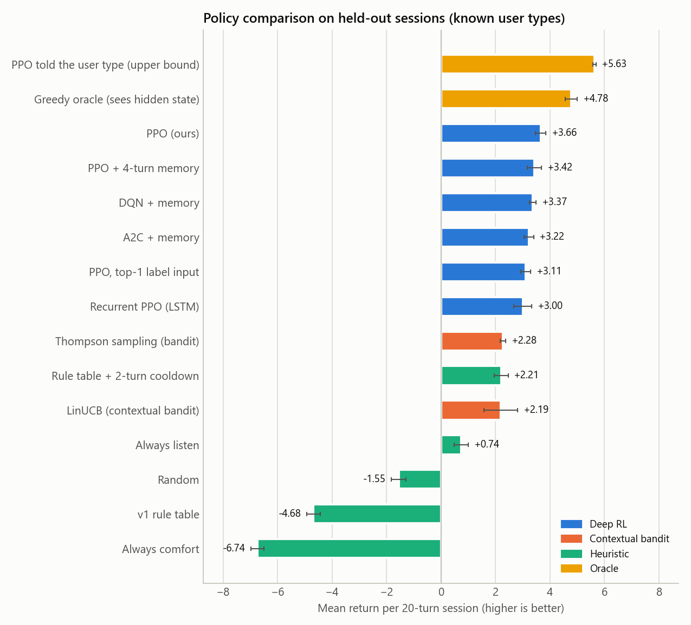
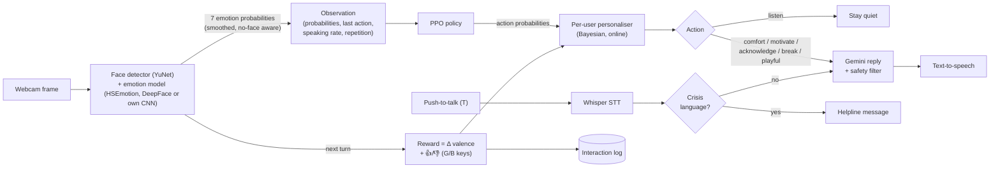
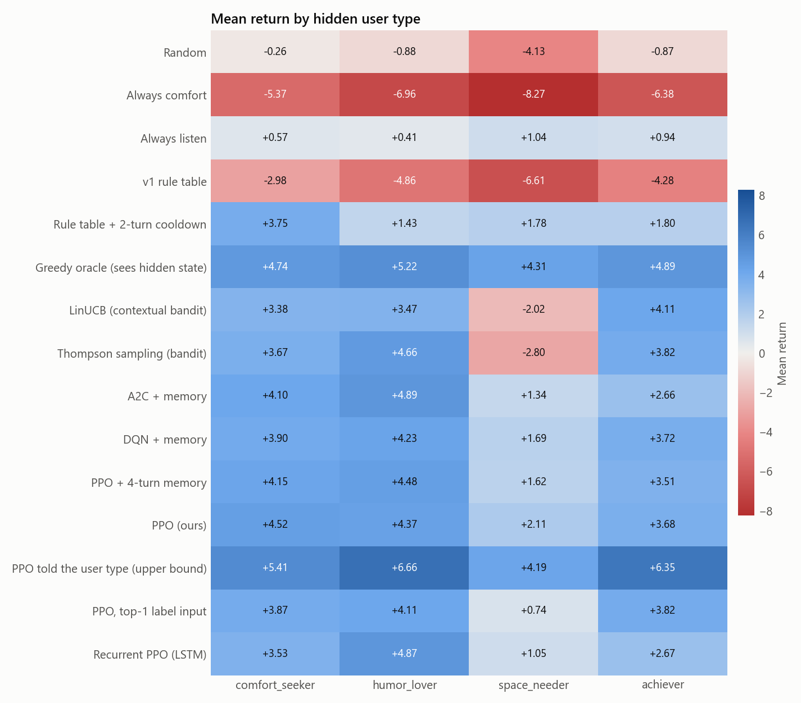
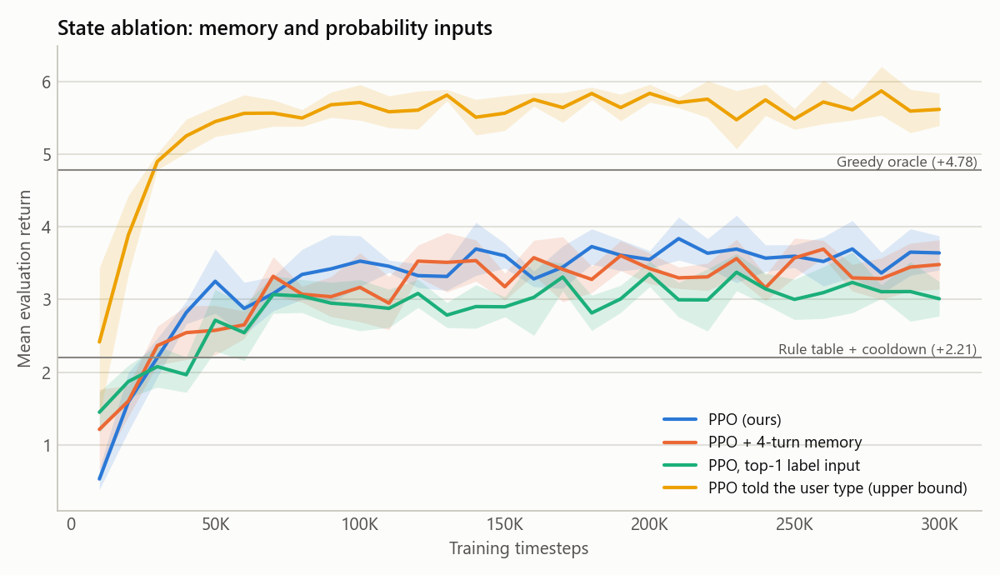
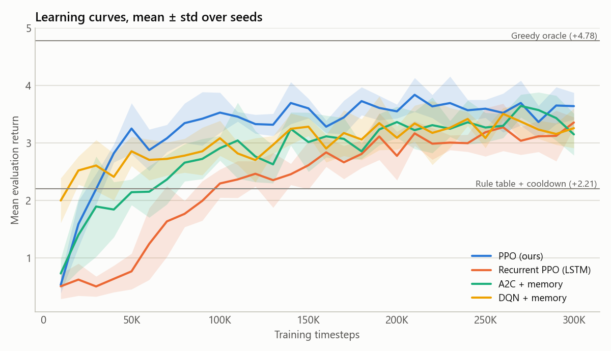
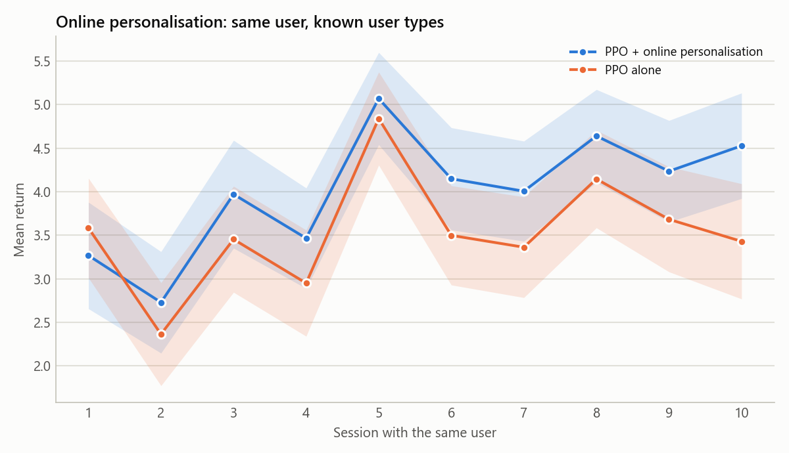

# Emotion-aware RL assistant

[](https://github.com/DIVY3200/Emotional-Aware-RL-Assistant/actions/workflows/ci.yml)


An assistant that **sees** how you feel through a webcam and uses a
**reinforcement-learning policy** to decide *whether* to say something and
*what kind* of response to give (comfort, motivate, acknowledge, suggest a
break, light humour, or stay quiet). An LLM words the reply and text-to-speech says it.

The policy is trained on a **user simulator with hidden user types**,
evaluated against baselines with confidence intervals, and **keeps learning
online** for each user from how their expression changes and from 👍/👎 key
presses.

<!-- Record a 10–20 s screen capture of the live assistant and save it as docs/demo.gif -->
<!--  -->



**Highlights** (1,000 held-out sessions × 5 training seeds, 95% confidence intervals):

| Policy | Mean return per 20-turn session |
|---|---|
| **PPO (ours)** | **+3.66 ± 0.19** |
| Best hand-written policy (v1 rule table + cooldown) | +2.21 ± 0.26 |
| Contextual bandits (LinUCB / Thompson sampling) | +2.19 / +2.28 |
| v1's rule table, talking every turn | −4.68 ± 0.25 |
| *PPO told the hidden user type (upper bound)* | *+5.63 ± 0.06* |

- The learned policy beats the best hand-written one by **+1.45 per session**
  (paired Wilcoxon p ≈ 10⁻²⁸). It also learned **when to stay quiet**,
  speaking in 55% of turns, and it generalises to user types it never saw (+3.74 vs +1.96).
- **Online personalisation** adds **+0.69 ± 0.22 per session** for a
  returning user by sessions 6–10 (p ≈ 10⁻⁷). It does *not* help for blended,
  in-between users (+0.03 ± 0.19).
- **Negative result, kept in:** within-session memory (4-turn history or an
  LSTM) did *not* help (−0.24 and −0.66). With a 65%-accurate detector, one
  20-turn session gives too little signal to identify the user. Remembering
  the user *across* sessions is what recovers part of the gap to the upper bound.

---

## Contents

1. [How it works](#how-it-works)
2. [The RL problem](#the-rl-problem)
3. [Results](#results)
4. [Quick start](#quick-start)
5. [Reproduce every number](#reproduce-every-number)
6. [Emotion detection: measure it, or train your own](#emotion-detection-measure-it-or-train-your-own)
7. [User study](#user-study)
8. [Project structure](#project-structure)
9. [Limitations and ethics](#limitations-and-ethics)
10. [What changed from v1](#what-changed-from-v1)
11. [References](#references)

---

## How it works



Every `decision_interval` seconds (4 s by default) is one **turn**, the same
unit as a simulator step:

1. **Close the previous turn.** Reward = how the user's detected valence
   changed, plus explicit feedback. The transition is logged, and the user's
   profile is updated.
2. **Observe.** The detector's 7 emotion probabilities (not just the top label)
   plus the last action, recent speaking rate and repetition. (A history of
   earlier turns is supported, but the validation-selected agent uses only the
   current turn; see the ablations.)
3. **Decide.** PPO proposes a distribution over 6 actions. The personaliser
   re-ranks the *speaking* actions with what it has learned about this user.
   PPO alone decides *when* to stay quiet.
4. **Speak.** The action becomes a natural instruction for the LLM ("kindly
   suggest they take a short break"). The reply is filtered and spoken in a
   background thread, so the video never freezes.

**Two phases.** The agent is trained offline on the simulator (thousands of
sessions per minute) and then deployed live, where it keeps adapting per user.

## The RL problem

The task is a partially observable MDP. The agent never sees the user's true
emotion or their type, only a noisy detector reading.

| Element | Definition |
|---|---|
| **Hidden state** | true emotion (7 FER classes), user type, conversational fatigue, last action, repeat count |
| **Observation** | detector probabilities (7) + last action (6) + speaking rate + repetition + session time; optionally stacked over earlier turns (`--history-len`) |
| **Actions** | `comfort`, `motivate`, `acknowledge`, `suggest_break`, `playful`, `listen` (stay quiet) |
| **Transition** | `P(s′ \| s, a, u) ∝ T₀[s, s′] · exp(β · e_eff(u, s, a) · valence(s′))` (see below) |
| **Reward** | `v(s′) + 0.5·(v(s′) − v(s)) − 0.05·[spoke] − 0.10·[repeated]`, where `v` is valence on Russell's circumplex |
| **Episode** | 20 turns, γ = 0.95 |

**User simulator** ([`simulator.py`](src/emotion_rl/simulator.py)):

- `T₀` is the natural emotional drift, the v1 transition matrix smoothed so
  every emotion is reachable.
- Each session samples a **hidden user type** with its own table
  `e(u, emotion, action) ∈ [-1, 1]`, plus per-user noise. A positive `e` tilts
  the next emotion towards positive valence; a negative `e` backfires.
- `e_eff` **decays when the same response is repeated** and **turns negative
  when the user is fatigued by too much talking**. Staying quiet lets fatigue
  recover, so the agent has to learn *when not to speak*.
- The agent sees a **simulated detector**: the top-1 label follows a confusion
  matrix (65% accuracy by default, with FER-style confusions such as fear ↔ surprise
  and sad ↔ neutral), and the full probability vector is Dirichlet-noised.
  You can plug in a confusion matrix measured on FER2013 (see below).

| User type | Responds best to | Dislikes |
|---|---|---|
| `comfort_seeker` | comfort, especially when sad or afraid | jokes when upset |
| `humor_lover` | light humour, even when sad or annoyed | being told to take a break when happy |
| `space_needer` | breaks and silence; tires quickly of talk | chatter, motivation, jokes when upset |
| `achiever` | motivation | comfort (feels patronising) |

All of these numbers are **modelling assumptions**. They are documented in the code
and can be recalibrated from real interaction logs (`python -m emotion_rl.study --effects`).

## Results

All numbers come from `python -m emotion_rl.evaluate`. They use 1,000 held-out
sessions whose user seeds were never used in training, with **5 training seeds**
per agent. Every policy meets the same users and starting emotions (common
random numbers), so differences are paired. For trained agents the ± is a 95% CI
across training seeds; for fixed policies it is across sessions.

### Main comparison (the four known user types)

| Policy | Mean return (95% CI) | Mean valence | Speaks |
|---|---|---|---|
| *PPO told the user type (upper bound, cheats)* | *+5.63 ± 0.06* | +0.302 | 55% |
| *Greedy oracle (sees hidden state, cheats)* | *+4.78 ± 0.22* | +0.276 | 75% |
| **PPO (ours)** | **+3.66 ± 0.19** | **+0.201** | 55% |
| PPO + 4-turn memory | +3.42 ± 0.26 | +0.192 | 56% |
| DQN + memory | +3.37 ± 0.12 | +0.188 | 55% |
| A2C + memory | +3.22 ± 0.18 | +0.178 | 51% |
| PPO, top-1 label input | +3.11 ± 0.19 | +0.177 | 57% |
| Recurrent PPO (LSTM) | +3.00 ± 0.33 | +0.169 | 51% |
| Thompson sampling (contextual bandit) | +2.28 ± 0.10 | +0.144 | 75% |
| Rule table + 2-turn cooldown | +2.21 ± 0.26 | +0.121 | 35% |
| LinUCB (contextual bandit) | +2.19 ± 0.62 | +0.139 | 71% |
| Always stay quiet | +0.74 ± 0.26 | +0.032 | 0% |
| Random | −1.55 ± 0.28 | −0.024 | 83% |
| v1 rule table (talks every turn) | −4.68 ± 0.25 | −0.146 | 100% |
| Always comfort | −6.74 ± 0.24 | −0.189 | 100% |

Paired differences against PPO (ours) are all significant at p < 0.001.
Full tables, including unseen users and every paired test, are in
[`results/results.md`](results/results.md), and raw numbers in
[`results/summary.json`](results/summary.json).

**Why RL beats the bandits.** Bandits optimise the *next* turn only. They
keep talking (71–75% of turns), so fatigue builds up and the session ends worse,
most visibly with `space_needer` users, where Thompson sampling collapses to
−2.80 while PPO stays at +2.11:



### Generalisation to unseen users

Test users that blend two types with random weights, which never appear in training:

| Policy | Mean return |
|---|---|
| *PPO told the user type (upper bound)* | *+4.35 ± 0.06* |
| **PPO (ours)** | **+3.74 ± 0.10** |
| LinUCB / Thompson sampling | +2.10 / +2.03 |
| Rule table + 2-turn cooldown | +1.96 ± 0.25 |

### Ablations: what the agent needs to see

| Variant (PPO, 5 seeds each) | Return | Effect |
|---|---|---|
| **Detector probabilities, no memory (ours)** | **+3.66** | |
| + 4-turn history | +3.42 | −0.24 ± 0.12 (p < 0.001) |
| LSTM memory instead (recurrent PPO) | +3.00 | −0.66 ± 0.15; still improving at 300k steps |
| Top-1 label instead of probabilities (4-turn history) | +3.11 | −0.31 vs the same agent with probabilities |
| Told the hidden user type (privileged teacher) | +5.63 | +1.97: the value of knowing the user |



The full probability vector is worth keeping: a detector's second guess
carries information. Memory did not pay off within one session, and that
finding shaped Tier 2: personalisation remembers the user **across** sessions instead.



### Robustness to a worse (or better) emotion detector

Agents trained at 65% detector accuracy, evaluated at other accuracies
(250 sessions × 5 seeds per point):

| Detector top-1 accuracy | 45% | 55% | 65% (train) | 75% | 85% | perfect |
|---|---|---|---|---|---|---|
| **PPO (ours)** | +3.08 | +3.47 | +3.84 | +3.55 | +3.84 | +4.22 |
| PPO, top-1 label input | +2.48 | +3.10 | +3.02 | +3.16 | +3.33 | +3.63 |
| Rule table + cooldown | +2.03 | +2.21 | +2.31 | +2.49 | +2.54 | +2.42 |

The learned policy degrades gracefully: even at 45% accuracy it beats the rule
table running on a *perfect* detector.

### Online personalisation

The same user returns for 10 sessions. The personaliser starts from the
population policy, explores a little in the first sessions, and then
specialises:



| Sessions 6–10, gain over PPO alone | Mean (95% CI) | p |
|---|---|---|
| Known user types | **+0.69 ± 0.22** | 9 × 10⁻⁸ |
| Unseen blended users | +0.03 ± 0.19 | 0.62 (no effect) |

The personaliser's strength (η = 8) was tuned on separate validation users.
A first version, with an independent estimate for every emotion × response
pair, showed no gain at all. What made it work was sharing what is learned
across emotions (a hierarchical model: "this user likes humour" applies
whether they are sad or annoyed).

### Real-webcam test (Logitech Brio 100, one user)

`python -m emotion_rl.camera_check --user <name>` voices 10 prompts: relax, talk, six
posed expressions, leave, come back. It records what each emotion model reads on the
same frames, then saves the best model for that user. On the author's face, held-out
recall (second half of each expression):

| Model | Macro recall | angry | disgust | fear | happy | sad | surprise | neutral |
|---|---|---|---|---|---|---|---|---|
| **HSEmotion (AffectNet)** | **86%** | 100% | 100% | 100% | 100% | 0% | 100% | 100% |
| DeepFace (FER2013, v1's model) | 29% | 87% | 0% | 0% | 87% | 0% | 0% | 28% |

What the live tests taught us, all fixed in the code:

- **Per-user calibration can backfire.** A bias fitted on posed expressions lifted
  posed "sad" from 0% to 80%, but in a live session it turned 54% of neutral moments
  into false "disgust". Calibration is now enabled only if it also keeps false alarms
  low while the user **talks naturally** (a dedicated step in the check). For the author
  it stayed off.
- **Sad stays the hard case.** A subtle sad face reads as neutral, and a pout reads as
  disgust. A talking mouth is misread too (10% of talking frames after smoothing), so the
  assistant makes no decisions while the user is talking.
- **Audio:** Windows routed speech to a monitor without speakers, and pyttsx3 went silent
  after its first sentence in a background thread. The app now uses SAPI directly and skips
  monitor audio. Push-to-talk stops the assistant's own speech before recording (it had
  transcribed itself), ends recording when the user pauses, and ignores Whisper's
  "Thank you." on silence. In a loopback test (laptop speakers to the Brio mic) the
  sentence came back with one word wrong.
- **Camera:** OpenCV's default Windows backend took over 2 minutes to open the Brio, and
  numbered the cameras differently; DirectShow opens it in about 3 s.

### Live pipeline latency (this laptop, CPU only)

| Stage | Latency |
|---|---|
| Face + emotion detection (YuNet + HSEmotion), live session | 61 ms p50 / 72 ms p95 per frame (background thread) |
| Policy decision (PPO / PPO + personaliser) | 0.3 ms / 0.7 ms |
| Reply generation (`gemini-flash-lite-latest`, minimal thinking) | ~1.2 s typical; local reply after an 8 s timeout |
| Speech-to-text (Whisper `small.en`, one sentence) | ~2 s after you stop talking |

The live app writes a per-session latency report (p50/p95 per stage) to the
interaction log on exit.

## Quick start

```bash
git clone https://github.com/DIVY3200/Emotional-Aware-RL-Assistant.git
cd Emotional-Aware-RL-Assistant
python -m venv venv
source venv/Scripts/activate          # Windows (Git Bash); macOS/Linux: source venv/bin/activate
pip install -e ".[all]"               # or: pip install -r requirements.txt && pip install -e . --no-deps
pytest -q                             # 87 tests, under a minute on a laptop CPU
```

Add your Gemini key to a `.env` file (optional; without it, local replies are used):

```env
GEMINI_API_KEY=your_key_here
```

**Browser demo** (no webcam needed: simulator playground + photo tab):

```bash
streamlit run src/emotion_rl/web_demo.py
```

**Live webcam assistant:**

```bash
python -m emotion_rl.assistant.app --user yourname          # personalised to you
python -m emotion_rl.assistant.app --camera 1 --no-llm --mute  # offline, silent
python -m emotion_rl.assistant.app --voice-input             # push-to-talk with Whisper
```

| Key | Action |
|---|---|
| `G` / `B` | that response helped / did not help (reward signal) |
| `T` | talk: records 5 s and transcribes it locally (with `--voice-input`) |
| `P` | pause |
| `Q` | quit; saves your profile, the interaction log and a latency report |

All settings live in [`configs/default.yaml`](configs/default.yaml).

**Docker** (web demo only; the live assistant needs local camera and audio):

```bash
docker build -t emotion-rl . && docker run -p 8501:8501 emotion-rl
```

## Reproduce every number

```bash
bash scripts/run_all_experiments.sh        # 7 agents × 5 seeds × 300k steps, then evaluation
```

That trains everything (resumable: finished seeds are skipped), evaluates it,
writes `results/`, and exports the deployed model to `models/ppo_best.zip`. The
seed is chosen by **validation** return, never by test results. Individual steps:

```bash
python -m emotion_rl.train --algo ppo --history-len 1 --tag ppo_no_memory   # main agent
python -m emotion_rl.train --algo ppo --history-len 4 --tag ppo              # memory ablation
python -m emotion_rl.train --algo recurrent_ppo --history-len 1
python -m emotion_rl.train --algo ppo --privileged --tag ppo_privileged  # upper bound
python -m emotion_rl.evaluate --runs runs --out results
```

## Emotion detection: measure it, or train your own

v1 quoted a published accuracy figure. v2 measures the detector instead:

```bash
# FER2013 from https://www.kaggle.com/datasets/msambare/fer2013 unzipped into data/fer2013/
python -m emotion_rl.detector_eval --fer data/fer2013/test --backends skip opencv
python -m emotion_rl.emotion_cnn --data data/fer2013 --epochs 40       # your own CNN
python -m emotion_rl.detector_eval --custom-model models/emotion_cnn.pt
python -m emotion_rl.train --confusion results/detector_deepface-skip_confusion.npy  # sim2real
python -m emotion_rl.detector_eval --camera 0 --seconds 30             # smoothing ablation
python -m emotion_rl.camera_check --user yourname                      # 2-min guided check: picks the best model for your face
```

Detector fixes in v2 ([`detector.py`](src/emotion_rl/detector.py)):

- DeepFace expects **BGR**; v1 passed RGB.
- When nobody is in frame, DeepFace still returns an emotion for the whole
  image. v2 detects this (`face_confidence = 0`) and the assistant pauses.
- The face detector is now **YuNet**. On a quick check, OpenCV's Haar cascade
  reported a "face" in a photo of a flower, and its confidence score could not
  separate it from a real face (1.00 vs 0.94). YuNet rejected it and runs at
  about 80 ms per frame on CPU.
- Smoothing uses an EMA over the probability vector with hysteresis, and the
  displayed confidence belongs to the displayed label.
- Detection runs in a background thread, so the preview never stalls.

## User study

[`docs/user_study.md`](docs/user_study.md) is a ready-to-run protocol. It covers:

- a within-subject design with three blinded conditions (`--condition A|B|C`)
- a Latin-square order, consent text and a questionnaire template
- the analysis: `python -m emotion_rl.study` runs Friedman and Holm-corrected
  Wilcoxon tests on the logged valence changes and the questionnaire

## Project structure

```
emotion_rl/
├── src/emotion_rl/
│   ├── emotions.py         emotion/action vocabularies, valence, v1 rule table
│   ├── simulator.py        user simulator: user types, fatigue, detector noise
│   ├── env.py              Gymnasium environment, observation builder, reward
│   ├── policies.py         baselines, greedy oracle, SB3 wrapper
│   ├── bandits.py          LinUCB, Thompson sampling, online personaliser
│   ├── train.py            multi-seed training (PPO, A2C, DQN, recurrent PPO)
│   ├── evaluate.py         full evaluation suite, statistics, figures
│   ├── plots.py            figure style
│   ├── detector.py         face + emotion detection, smoothing, worker thread
│   ├── detector_eval.py    FER2013 evaluation, smoothing ablation
│   ├── emotion_models.py   HSEmotion / DeepFace / own-CNN classifiers, per-user calibration
│   ├── camera_check.py     guided webcam check that measures the detector on your face
│   ├── emotion_cnn.py      train your own FER2013 CNN
│   ├── study.py            user-study analysis
│   ├── web_demo.py         Streamlit demo
│   └── assistant/          live app, LLM, speech, safety, logging, latency
├── tests/                  pytest suite (runs in CI without TensorFlow)
├── configs/default.yaml    all live-assistant settings
├── scripts/                run_all_experiments.sh
├── docs/                   user-study protocol and templates
├── models/                 deployed agent (ppo_best.zip + its config)
├── results/                evaluation outputs and figures
└── legacy/v1/              the original version + an audit script
```

## Limitations and ethics

- **Simulated users are not real users.** The user types and effect sizes are
  assumptions. The simulator is how the agent learns safely before meeting
  people; the user study and the logged effect table are how to check it.
- **Facial expression is not emotion.** Expressions are culture- and
  person-dependent, and FER2013 is known to be demographically imbalanced and
  noisily labelled. Detector accuracy is about 60–70% even in good conditions,
  which is why the policy is trained on noisy, probabilistic observations and
  the prompt tells the LLM never to state an emotion as fact.
- **Not a mental-health tool.** Crisis language triggers a helpline message
  (configurable; check the numbers for your country), and long periods of low
  mood trigger a gentle suggestion to talk to someone. Neither is a substitute
  for professional help.
- **Privacy.** No images are stored. Logs hold emotion probabilities, actions,
  replies and (only with push-to-talk) transcripts, under a user code. `data/`
  is git-ignored.
- **Consent.** Run it only on people who have agreed to it. The user-study
  protocol includes consent text.

## What changed from v1

The semester version is kept in [`legacy/v1/`](legacy/v1/) with an audit script
that reproduces each problem. Most importantly, in v1 **the action had no
effect on the next emotion**, and a reward-sign bug **rewarded making a happy
user sad (+1.00)**. The only action-dependent reward was a bonus for matching a
hand-written table, so PPO just learned to copy that table, and it still scored
lower than the table itself (+7.40 vs +7.99). v2 rebuilt the RL core around a
simulator where actions matter, then added rigorous evaluation, online
learning, and engineering quality. See [`legacy/v1/README.md`](legacy/v1/README.md).

## References

- Russell, J. A. (1980). A circumplex model of affect. *Journal of Personality and Social Psychology*, 39(6).
- Ng, A. Y., Harada, D., & Russell, S. (1999). Policy invariance under reward transformations. *ICML*.
- Schulman, J. et al. (2017). Proximal policy optimization algorithms. *arXiv:1707.06347*.
- Li, L., Chu, W., Langford, J., & Schapire, R. E. (2010). A contextual-bandit approach to personalized news article recommendation. *WWW*.
- Agrawal, S., & Goyal, N. (2013). Thompson sampling for contextual bandits with linear payoffs. *ICML*.
- Goodfellow, I. et al. (2013). Challenges in representation learning: a report on three machine learning contests (FER2013). *ICONIP*.
- Radford, A. et al. (2023). Robust speech recognition via large-scale weak supervision (Whisper). *ICML*.
- Raffin, A. et al. (2021). Stable-Baselines3: reliable reinforcement learning implementations. *JMLR*.
- [DeepFace](https://github.com/serengil/deepface), [YuNet / OpenCV Zoo](https://github.com/opencv/opencv_zoo), [Gymnasium](https://gymnasium.farama.org).

## Author

**Divyansh Kaushal** · [divyanshkaushal.tech](https://divyanshkaushal.tech) · [GitHub @DIVY3200](https://github.com/DIVY3200)
