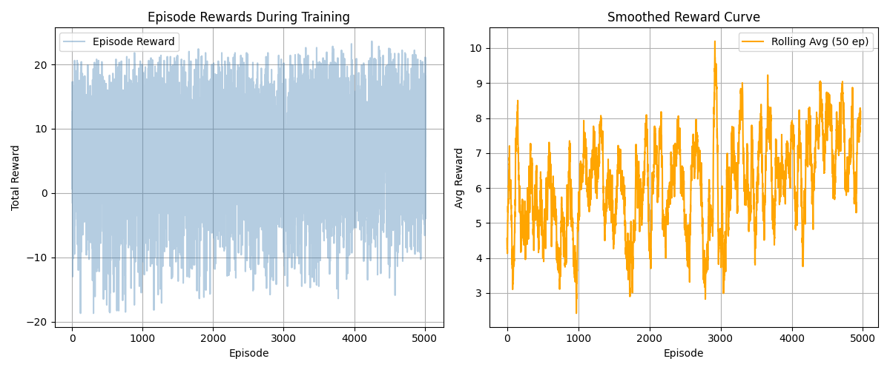

# 🧠 Emotion-Aware Reinforcement Learning Assistant

> A real-time intelligent assistant that **sees** your emotion through a webcam, **decides** how to respond using a trained **PPO reinforcement learning agent**, **generates** an empathetic message with **Gemini AI**, and **speaks** it aloud using text-to-speech.

**Computer Vision + Reinforcement Learning + LLM + Speech — all working together in real time.**

---

## 📑 Table of Contents

1. [Overview](#-overview)
2. [How It Works — Full Pipeline](#-how-it-works--full-pipeline)
3. [Tech Stack](#-tech-stack)
4. [Project Structure](#-project-structure)
5. [Setup From Scratch](#-setup-from-scratch)
6. [Running the Project — Step by Step](#-running-the-project--step-by-step)
7. [The Four Core Modules Explained](#-the-four-core-modules-explained)
8. [Reinforcement Learning Formulation](#-reinforcement-learning-formulation)
9. [Results](#-results)
10. [Troubleshooting](#-troubleshooting)
11. [Future Scope](#-future-scope)
12. [Author](#-author)

---

## 🎯 Overview

Traditional assistants respond the same way regardless of how you feel. This project builds an assistant that **adapts to your emotional state**. It detects 7 facial emotions, and a reinforcement learning agent learns the *best response strategy* for each — comforting you when sad, motivating you when surprised, and cheering with you when happy.

**Key idea:** Instead of hardcoded if-else rules, a **PPO agent learns the optimal response policy** by training on thousands of simulated emotional interactions.

---

## 🔄 How It Works — Full Pipeline

```
┌─────────────────────────────────────────────────────────────────┐
│                      REAL-TIME PIPELINE                          │
└─────────────────────────────────────────────────────────────────┘

   [1] WEBCAM CAPTURE                    (OpenCV)
        │   captures live video frames
        ▼
   [2] FACE DETECTION + EMOTION          (DeepFace / FER2013)
        │   detects face, classifies into 7 emotions
        │   applies bounding-box smoothing + majority voting
        ▼
   [3] STATE VECTOR                       (Feature Engineering)
        │   emotion → 7-dim one-hot vector  e.g. happy → [0,0,0,1,0,0,0]
        ▼
   [4] PPO AGENT DECISION                 (Stable-Baselines3)
        │   reads state → selects 1 of 5 response actions
        │   (comfort / motivate / neutral / suggest_break / playful)
        ▼
   [5] RESPONSE GENERATION                (Gemini 1.5 Flash API)
        │   emotion + action → natural empathetic text
        ▼
   [6] TEXT-TO-SPEECH                     (pyttsx3, queue-based)
        │   speaks the response aloud  🔊
        ▼
   [7] LIVE UI OVERLAY                    (OpenCV)
            shows emotion box, PPO action, response text,
            emotion log, PPO step counter, speaking indicator
```

There are **two phases** in this project:

| Phase | What happens | Script |
|-------|--------------|--------|
| **Training (offline)** | PPO agent learns optimal responses on simulated emotions | `train_ppo.py` |
| **Inference (live)** | Trained agent runs on real webcam emotions | `run_assistant.py` |

---

## 🛠️ Tech Stack

| Layer | Technology |
|-------|------------|
| **Computer Vision** | OpenCV, DeepFace |
| **Emotion Classes** | FER2013 (7 classes) |
| **Reinforcement Learning** | Stable-Baselines3 (PPO) |
| **RL Environment** | Gymnasium (custom) |
| **Deep Learning Backend** | TensorFlow, Keras, PyTorch |
| **Language Model** | Google Gemini 1.5 Flash |
| **Text-to-Speech** | pyttsx3 |
| **Metrics** | scikit-learn |
| **Config / Secrets** | python-dotenv |

---

## 📂 Project Structure

```
emotion_rl/
│
├── emotion_detector.py      # [Module 1] OpenCV + DeepFace emotion detection
├── rl_environment.py        # [Module 2] Custom Gymnasium RL environment
├── train_ppo.py             # [Module 3] Train + evaluate the PPO agent
├── run_assistant.py         # [Module 4] Live webcam assistant (MAIN DEMO)
├── evaluate_metrics.py      # Compute accuracy / precision / recall / F1
│
├── requirements.txt         # All Python dependencies
├── .env                     # GEMINI_API_KEY (NOT committed)
├── .gitignore
├── README.md
│
├── model/                   # Trained PPO models
│   └── ppo_agent/
│       ├── best_model.zip       # Best model (auto-saved during training)
│       └── ppo_emotion_final.zip
│
├── models/                  # Training artifacts
│   ├── ppo_logs/                # TensorBoard logs
│   ├── training_rewards.png     # Reward curve plot
│   ├── ppo_confusion_matrix.png # PPO decision metrics
│   └── deepface_confusion_matrix.png
│
└── data/                    # (optional) FER2013 dataset for metrics
    └── fer2013/
        ├── train/
        └── test/
```

---

## ⚙️ Setup From Scratch

### Prerequisites

- **Python 3.10 or 3.11** (TensorFlow does not fully support 3.12+)
- A **webcam** (built-in or USB)
- A free **Gemini API key** → [Get one here](https://aistudio.google.com)

---

### Step 1 — Clone the repository

```bash
git clone https://github.com/yourusername/emotion_rl.git
cd emotion_rl
```

### Step 2 — Create and activate a virtual environment

```bash
# Create venv with Python 3.10
py -3.10 -m venv venv

# Activate (Windows / Git Bash)
source venv/Scripts/activate

# Activate (Mac / Linux)
source venv/bin/activate
```

You should see `(venv)` in your terminal prompt.

### Step 3 — Install dependencies

```bash
pip install -r requirements.txt
```

> ⏱️ This takes 5-15 minutes. If `pip install -r` hangs, install packages individually (torch, tensorflow, and deepface are the largest).

### Step 4 — Configure your API key

Create a file named `.env` in the project root:

```env
GEMINI_API_KEY=your_actual_gemini_api_key_here
```

> ⚠️ The `.env` file is in `.gitignore` — never commit your API key.

### Step 5 — Verify installation

```bash
python -c "import cv2, tensorflow, stable_baselines3, deepface, pyttsx3; print('All packages OK!')"
```

---

## ▶️ Running the Project — Step by Step

### 1️⃣ Test emotion detection (optional sanity check)

```bash
python emotion_detector.py
```
Opens your webcam, draws a stable bounding box, and prints detected emotion + confidence. Press **Q** to quit.

### 2️⃣ Test the RL environment (optional)

```bash
python rl_environment.py
```
Runs one simulated episode with random actions to verify the environment, reward function, and emotion transitions work.

### 3️⃣ Train the PPO agent

```bash
python train_ppo.py --mode train
```
- Trains for **100,000 timesteps** (~5-10 min)
- Saves best model to `model/ppo_agent/best_model.zip`
- Saves reward plot to `models/training_rewards.png`

### 4️⃣ Evaluate the trained agent

```bash
python train_ppo.py --mode eval
```
Runs 5 deterministic episodes and prints total reward per episode.

### 5️⃣ Compute metrics (accuracy, precision, recall, F1)

```bash
pip install scikit-learn      # if not already installed
python evaluate_metrics.py
```
Outputs PPO decision metrics + confusion matrices. If FER2013 is in `data/`, also computes real DeepFace accuracy.

### 6️⃣ Run the live assistant (MAIN DEMO) 🎬

```bash
python run_assistant.py
```
- Opens webcam, greets you with speech
- Detects emotion → PPO decides → Gemini generates → speaks aloud
- Shows live UI overlay
- Press **Q** to quit

---

## 🧩 The Four Core Modules Explained

### Module 1 — `emotion_detector.py`
Captures webcam frames and classifies emotion using DeepFace. Key innovation: **temporal smoothing** over a 5-frame window plus **majority voting** to eliminate bounding-box flickering and unstable labels. Outputs a 7-dimensional one-hot emotion vector.

### Module 2 — `rl_environment.py`
A custom **Gymnasium environment** that models the assistant-user interaction as a Markov Decision Process. Defines the state space (emotions), action space (responses), reward function (emotion improvement), and a probabilistic emotion-transition model for offline training.

### Module 3 — `train_ppo.py`
Trains the **PPO agent** using Stable-Baselines3 on the custom environment. Includes a reward-tracking callback, evaluation callback, automatic model saving, and reward-curve plotting. Supports both `--mode train` and `--mode eval`.

### Module 4 — `run_assistant.py`
The full real-time integration. Combines webcam, emotion detection, the trained PPO agent, Gemini API response generation, and a **queue-based threaded speech engine** (to prevent audio/UI freezing). Renders a live overlay showing all system activity.

---

## 📐 Reinforcement Learning Formulation

The interaction is modeled as an MDP = (S, A, P, R, γ):

| Element | Definition |
|---------|------------|
| **State (S)** | 7-dim one-hot emotion vector |
| **Action (A)** | 5 responses: comfort, motivate, neutral, suggest_break, playful |
| **Reward (R)** | +1 if emotion improves, −1 if worsens, −0.1 if unchanged, +bonuses |
| **Transition (P)** | Probabilistic emotion-transition matrix (simulation) |
| **Discount (γ)** | 0.99 |

**Reward function:**
```
r_total = sign(P(s') - P(s))           # base: emotion positivity change
        + 1.0  if negative_emotion → happy   # recovery bonus
        + 0.2  if action == optimal_action   # contextual bonus
```

**PPO hyperparameters:** learning_rate=3e-4, n_steps=512, batch_size=64, n_epochs=10, gamma=0.99, gae_lambda=0.95, clip_range=0.2, ent_coef=0.01.

---

## 📊 Results

### PPO Evaluation (5 episodes)

| Episode | Starting Emotion | Total Reward |
|---------|-----------------|--------------|
| 1 | Happy | -0.40 |
| 2 | Sad | +16.30 ✅ |
| 3 | Angry | +16.20 ✅ |
| 4 | Happy | +4.10 |
| 5 | Neutral | +19.20 ✅ |
| **Average** | — | **+11.08** |

### Learned Policy

| Detected Emotion | PPO Action | Match |
|------------------|-----------|-------|
| Happy | Playful | ✅ |
| Sad | Comfort | ✅ |
| Angry | Comfort | ✅ |
| Fear | Suggest Break | ✅ |
| Neutral | Neutral | ✅ |
| Surprise | Motivate | ✅ |


---


## 🔧 Troubleshooting

| Problem | Solution |
|---------|----------|
| `Could not open webcam` | Change `WEBCAM_INDEX = 1` to `0` in `run_assistant.py` |
| `protobuf VersionError` | `pip install protobuf==4.25.3` |
| `No module named tf_keras` | `pip install tf-keras` |
| `google.generativeai deprecated` | Use `google-genai` (already in requirements) |
| `429 RESOURCE_EXHAUSTED` (Gemini) | Free-tier quota hit — wait, or switch model to `gemini-1.5-flash` |
| Speech only plays greeting | Ensure queue-based `SpeechEngine` is used (latest `run_assistant.py`) |
| Bounding box flickers | Use latest `emotion_detector.py` with smoothing window |
| `PPO model not found` | Train first: `python train_ppo.py --mode train` |

---

## 🔮 Future Scope

- [ ] Multi-modal emotion detection (voice tone + facial)
- [ ] Personalized RL policies per user (online fine-tuning)
- [ ] Continuous action space (SAC / TD3)
- [ ] LSTM-PPO for multi-turn conversational memory
- [ ] FastAPI backend + web frontend dashboard
- [ ] Docker + CI/CD + cloud deployment
- [ ] Edge deployment (Raspberry Pi / Jetson Nano)
- [ ] Reward learning from human feedback (RLHF)

---

## 📋 requirements.txt

```
opencv-python
tensorflow
keras
stable-baselines3
gymnasium
torch
numpy
pillow
matplotlib
pandas
tqdm
deepface
tf-keras
google-genai
pyttsx3
python-dotenv
scikit-learn
protobuf==4.25.3
```

---

## 👤 Author

**Divyansh Kaushal**


🌐 [divyanshkaushal.tech](https://divyanshkaushal.tech)

---

## 🙏 Acknowledgements

- [DeepFace](https://github.com/serengil/deepface) — Sefik Ilkin Serengil
- [Stable-Baselines3](https://github.com/DLR-RM/stable-baselines3) — DLR-RM
- [FER2013 Dataset](https://www.kaggle.com/datasets/msambare/fer2013) — Kaggle
- [Google Gemini API](https://aistudio.google.com)
- [OpenAI Gym / Gymnasium](https://gymnasium.farama.org)
```
